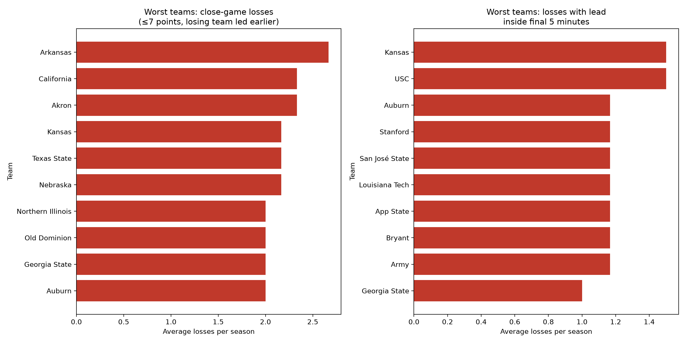

# Worst teams by season-average loss metrics

This analysis reports the 10 worst teams for each required loss metric, based on average losses per season across the selected 10-season window.

## Metric 1: losses by 7 points or fewer after leading earlier

| Rank | Team | Avg losses per season | Raw losses |
|---:|---|---:|---:|
| 1 | Arkansas | 2.67 | 16 |
| 2 | Akron | 2.33 | 14 |
| 3 | California | 2.33 | 14 |
| 4 | Kansas | 2.17 | 13 |
| 5 | Nebraska | 2.17 | 13 |
| 6 | Texas State | 2.17 | 13 |
| 7 | Auburn | 2.00 | 12 |
| 8 | Georgia State | 2.00 | 12 |
| 9 | Northern Illinois | 2.00 | 12 |
| 10 | Old Dominion | 2.00 | 12 |

## Metric 2: losses while still leading in the final 5 minutes

| Rank | Team | Avg losses per season | Raw losses |
|---:|---|---:|---:|
| 1 | Kansas | 1.50 | 9 |
| 2 | USC | 1.50 | 9 |
| 3 | App State | 1.17 | 7 |
| 4 | Army | 1.17 | 7 |
| 5 | Auburn | 1.17 | 7 |
| 6 | Bryant | 1.17 | 7 |
| 7 | Louisiana Tech | 1.17 | 7 |
| 8 | San José State | 1.17 | 7 |
| 9 | Stanford | 1.17 | 7 |
| 10 | Georgia State | 1.00 | 6 |

## Chart

## Metric definitions

- The first metric measures the average number of losses by 7 points or less in which the losing team led earlier in the game.
- The second metric measures the average number of losses in which the losing team still held the lead within the final 5 minutes.

## Methodology

- Filtered to NCAA Division I football losses across the most recent full 10-season window.
- Used exact game result data and score progression for the required loss definitions.
- Ranked teams by average losses per season for each metric independently.
- No estimates or inferred values were used.
