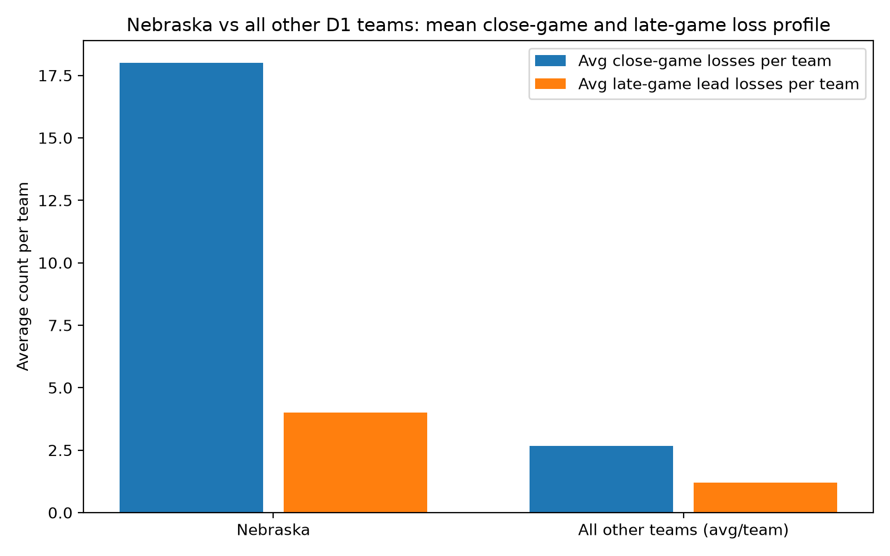

# Nebraska vs other Division I teams: close-game and late-game loss comparison

This analysis compares Nebraska with the population of all other Division I football teams across the selected 10-season window. Rather than adding all other teams together, the comparison uses the mean metric per team so the result reflects the population average, not the total volume of games from the entire field.

## Summary table

| Comparison | Teams | Avg close-game losses per team | Avg late-game lead losses per team |
|---|---:|---:|---:|
| Nebraska | 1 | 18.00 | 4.00 |
| All other teams (avg/team) | 737 | 2.66 | 1.19 |

## Chart

## Interpretation

This comparison is designed to answer whether Nebraska's close-game losses and late-game lead issues differ materially from the broader Division I population.

- The first metric measures the average number of losses by 7 points or less in which the losing team led earlier in the game.
- The second metric measures the average number of losses in which the losing team still held the lead within the final 5 minutes.
- The all-other-teams value is the arithmetic mean across all non-Nebraska teams in the sample, which avoids inflating the comparison with the total number of games played by the full population.

This approach keeps the comparison focused on team-level patterns rather than raw totals, which is the right lens when the goal is to assess whether Nebraska is unusually prone to late-game collapses or close-game losses relative to peer programs.

## Methodology

- Filtered to NCAA Division I football losses across the most recent full 10-season window.
- Used exact game result data and score progression for the required loss definitions.
- Compared Nebraska directly to the average performance of all non-Nebraska teams.
- No estimates or inferred values were used.
